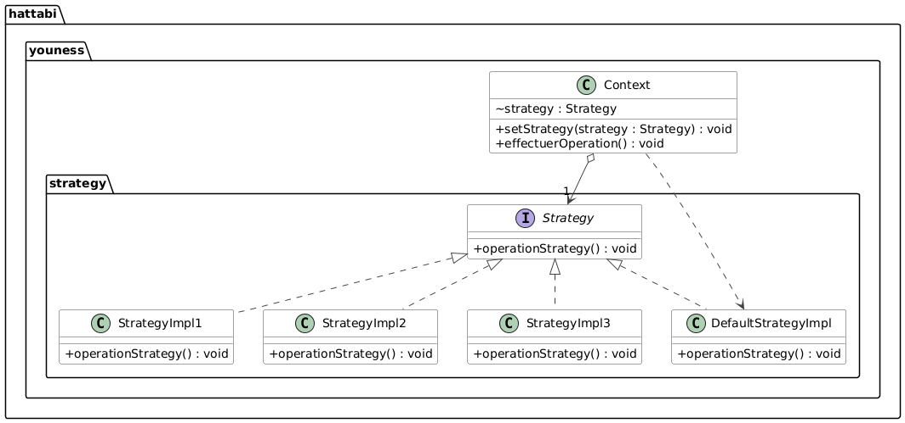
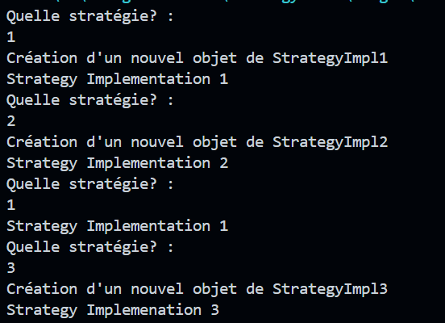

# Rapport de Travaux Pratiques : Design Pattern Strategy

**Encadrant :** Mohamed YOUSSFI  
**Étudiant :** Youness HATTABI

---

## Table des Matières

1. [Introduction](#1-introduction)
2. [Présentation du pattern](#2-présentation-du-pattern)
   - 2.1 [Problème posé](#21-problème-posé)
   - 2.2 [Solution proposée](#22-solution-proposée)
   - 2.3 [Acteurs du pattern](#23-acteurs-du-pattern)
3. [Diagramme de classes](#3-diagramme-de-classes)
4. [Implémentation](#4-implémentation)
   - 4.1 [L'interface `Strategy`](#41-linterface-strategy)
   - 4.2 [Les stratégies concrètes](#42-les-stratégies-concrètes)
   - 4.3 [Le contexte `Context`](#43-le-contexte-context)
   - 4.4 [La classe principale `Main`](#44-la-classe-principale-main)
5. [Tests et Résultats](#5-tests-et-résultats)
6. [Conclusion](#6-conclusion)

---

## 1. Introduction

Le pattern **Strategy** est un pattern de conception _comportemental_. Il permet de définir une famille d'algorithmes, de les encapsuler chacun dans une classe et de les rendre **interchangeables** à l'exécution, sans que le code qui les utilise ait à connaître leur implémentation.

Ce rapport présente une implémentation en Java de ce pattern, avec un contexte capable de changer de stratégie dynamiquement. Les stratégies sont choisies par l'utilisateur au clavier puis instanciées par **réflexion** (`Class.forName`), ce qui prolonge les mécanismes vus dans le TP sur l'injection des dépendances.

---

## 2. Présentation du pattern

### 2.1 Problème posé

Lorsqu'une classe doit adapter son comportement selon la situation (algorithme de tri, de calcul de prix, de compression, etc.), la solution naïve consiste à empiler des conditions (`if` / `switch`) dans cette classe. Le code devient alors long, difficile à tester, et chaque nouvelle variante oblige à **modifier** la classe existante.

### 2.2 Solution proposée

Le pattern Strategy sépare :

- le **contexte**, qui a besoin d'un comportement mais ne sait pas comment il est réalisé ;
- les **stratégies**, qui implémentent chacune une variante du comportement derrière une interface commune.

Le contexte détient une référence vers l'interface `Strategy` et lui délègue le travail. Changer de comportement revient à changer l'objet référencé, sans toucher au contexte.

### 2.3 Acteurs du pattern

| Rôle                    | Classe / Interface                                | Responsabilité                                              |
| ----------------------- | ------------------------------------------------- | ----------------------------------------------------------- |
| Stratégie (abstraction) | `Strategy`                                        | Déclare l'opération `operationStrategy()`                   |
| Stratégies concrètes    | `StrategyImpl1`, `StrategyImpl2`, `StrategyImpl3` | Chacune implémente une variante de l'opération              |
| Stratégie par défaut    | `DefaultStrategyImpl`                             | Comportement utilisé tant qu'aucune stratégie n'est choisie |
| Contexte                | `Context`                                         | Détient la stratégie courante et lui délègue l'exécution    |
| Client                  | `Main`                                            | Choisit la stratégie et la fournit au contexte              |

---

## 3. Diagramme de classes



Lecture du diagramme :

- `DefaultStrategyImpl`, `StrategyImpl1`, `StrategyImpl2` et `StrategyImpl3` **implémentent** `Strategy` (flèches pointillées).
- `Context` **détient** une `Strategy` (association, attribut `strategy`). Il ne connaît que l'interface, jamais les classes concrètes, hormis la valeur par défaut qu'il instancie.

**Organisation du projet :**

```
hattabiyounessn7-strategy-demo/
├── pom.xml
└── src/main/java/hattabi/youness/
    ├── Main.java
    ├── context/
    │   └── Context.java
    └── strategy/
        ├── Strategy.java
        ├── DefaultStrategyImpl.java
        ├── StrategyImpl1.java
        ├── StrategyImpl2.java
        └── StrategyImpl3.java
```

---

## 4. Implémentation

### 4.1 L'interface `Strategy`

L'interface définit le contrat commun à toutes les stratégies : une unique méthode, `operationStrategy()`.

```java
package hattabi.youness.strategy;

public interface Strategy {
    void operationStrategy();
}
```

---

### 4.2 Les stratégies concrètes

Chaque stratégie implémente `Strategy` et fournit sa propre variante de l'opération. Ici, elles affichent un message distinct afin de rendre visible la stratégie active.

**Stratégie par défaut :**

```java
package hattabi.youness.strategy;

public class DefaultStrategyImpl implements Strategy {
    public void operationStrategy() {
        System.out.println("Welcome to the strategy!!!");
    }
}
```

**Stratégies 1, 2 et 3 :**

```java
package hattabi.youness.strategy;

public class StrategyImpl1 implements Strategy {
    public void operationStrategy() {
        System.out.println("Strategy Implementation 1");
    }
}
```

```java
package hattabi.youness.strategy;

public class StrategyImpl2 implements Strategy {
    public void operationStrategy() {
        System.out.println("Strategy Implementation 2");
    }
}
```

```java
package hattabi.youness.strategy;

public class StrategyImpl3 implements Strategy {
    public void operationStrategy() {
        System.out.println("Strategy Implemenation 3");
    }
}
```

---

### 4.3 Le contexte `Context`

Le contexte détient la stratégie courante dans l'attribut `strategy`, initialisé avec `DefaultStrategyImpl` pour que le contexte soit toujours utilisable. `setStrategy` permet de changer de stratégie à l'exécution, et `effectuerOperation` délègue simplement l'appel à la stratégie courante.

```java
package hattabi.youness.context;

import hattabi.youness.strategy.*;

public class Context {
    Strategy strategy = new DefaultStrategyImpl();

    public void setStrategy(Strategy strategy) {
        this.strategy = strategy;
    }

    public void effectuerOperation() {
        strategy.operationStrategy();
    }
}
```

La méthode `effectuerOperation` ne contient aucune condition : le comportement dépend uniquement de l'objet injecté, c'est le **polymorphisme** qui fait le travail.

---

### 4.4 La classe principale `Main`

Le programme demande à l'utilisateur quelle stratégie utiliser, dans une boucle infinie. Le texte saisi (`1`, `2` ou `3`) est concaténé au préfixe `hattabi.youness.strategy.StrategyImpl` pour obtenir le nom de classe complet, qui est instancié par **réflexion**.

Les stratégies déjà créées sont conservées dans une `Map<String, Strategy>` : si l'utilisateur redemande une stratégie déjà utilisée, l'objet existant est réutilisé au lieu d'être recréé (principe du cache).

```java
package hattabi.youness;

import java.util.HashMap;
import java.util.Map;
import java.util.Scanner;

import hattabi.youness.context.Context;
import hattabi.youness.strategy.Strategy;

public class Main {
    public static void main(String[] args) throws Exception {
        Context context = new Context();
        Scanner scanner = new Scanner(System.in);
        Map<String, Strategy> strategiesMap = new HashMap<>();
        Strategy strategy;

        while (true) {
            System.out.println("Quelle stratégie? : ");
            String str = scanner.nextLine();
            strategy = strategiesMap.get(str);
            if (strategy == null) {
                System.out.println("Création d'un nouvel objet de StrategyImpl" + str);
                strategy = (Strategy) Class.forName("hattabi.youness.strategy.StrategyImpl" + str)
                        .getConstructor().newInstance();
                strategiesMap.put(str, strategy);
            }
            context.setStrategy(strategy);
            context.effectuerOperation();
        }
    }
}
```

Déroulement pour une saisie :

1. Lecture du numéro saisi.
2. Recherche dans la `Map` : si la stratégie existe déjà, on la réutilise.
3. Sinon, création par réflexion, puis mise en cache.
4. `context.setStrategy(strategy)` change la stratégie courante.
5. `context.effectuerOperation()` exécute la variante choisie.

---

## 5. Tests et Résultats

**Scénario de test :** saisie successive de `1`, `2`, `1`, puis `3`.

```
Quelle stratégie? :
1
Création d'un nouvel objet de StrategyImpl1
Strategy Implementation 1
Quelle stratégie? :
2
Création d'un nouvel objet de StrategyImpl2
Strategy Implementation 2
Quelle stratégie? :
1
Strategy Implementation 1
Quelle stratégie? :
3
Création d'un nouvel objet de StrategyImpl3
Strategy Implemenation 3
```

**Capture de l'exécution :**



Analyse :

- La première saisie de `1`, `2` et `3` provoque la **création** de l'objet correspondant (message « Création d'un nouvel objet »).
- La seconde saisie de `1` ne produit pas ce message : l'objet est **récupéré dans la `Map`**, sans nouvelle instanciation.
- Le contexte change de comportement à chaque saisie, sans qu'une seule ligne de `Context` ne soit modifiée.

---

## 6. Conclusion

Ce travail a permis d'implémenter le pattern Strategy et de le combiner avec la réflexion Java pour choisir les algorithmes à l'exécution. Le contexte reste simple et stable, tandis que les comportements évoluent indépendamment : c'est le même esprit de **couplage faible** que celui recherché par l'injection des dépendances.
